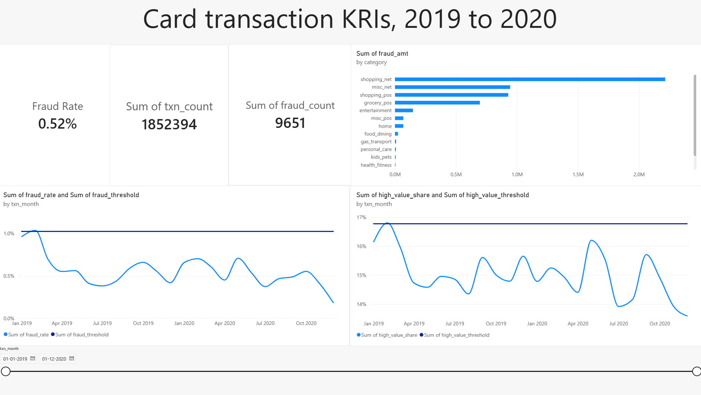

# Card transaction control dashboard

A Power BI dashboard that watches card transactions against risk thresholds.

  

## Why I built it

I had already built a loan default model for my ML course. A model only predicts, so I built this monitoring side on a card transaction dataset.
the two projects use different data

## What's in it

- Data: Sparkov synthetic card transactions from Kaggle, Jan 2019 to Dec 2020, 1,852,394 rows
- SQL in Postgres does all the work: `load.sql`, `base.sql`, `kri.sql`, `thresholds.sql`
- Power BI only reads the views and draws them: `dashboard.pbix`
- One DAX measure, the fraud rate

## The KRIs

- Fraud rate: fraud count over transaction count
- High-value share: spend above the 99th percentile (537.90) over total spend
- Fraud concentration: the share of fraud amount held by the top 3 categories, shown as a bar chart
- Data validity: rows failing basic checks (bad amount, dates, coordinates, nulls)

Thresholds are the mean plus 2 standard deviations of the 12 months of 2019 (fraud rate 1.02%, high-value share 16.78%). Then I tested 2020 against them. I kept the limits in a small table so they can change without touching the report.

## What I found

- Overall fraud rate is 0.52% (9,651 of 1,852,394)
- Only Feb 2019 breached, on both KRIs. It is inside the baseline, and it was a low-volume month, so fraud was a bigger share.
- No month of 2020 breached
- Validity is 0 invalid rows. The data is synthetic and clean, so that KRI has nothing to flag.

## How to run it

1. Put `fraudTrain.csv` and `fraudTest.csv` in a `data/` folder (not in the repo)
2. Create a database called `cardctl` in Postgres
3. From the project root run the files in order: `psql -U postgres -d cardctl -f sql/load.sql`, then `base.sql`, `kri.sql`, `thresholds.sql`
4. Open `dashboard.pbix` and point it at your Postgres

My Postgres runs on port 5433, so change the port if yours differs.

## What broke

- Postgres installed on port 5433 instead of 5432, because an old install was still holding 5432
- I forgot a semicolon, so my password change never ran and I was locked out
- Power BI loaded the threshold columns as blank. They were 40 digits long and Power BI can't hold that, so I rounded them to 6 decimals in SQL.

## Limits

- Static dataset, no live feed
- Mean plus 2 standard deviations is a simple rule, and with only 12 baseline months one baseline month can breach
- Synthetic data, so the numbers show the method and not real card behaviour
